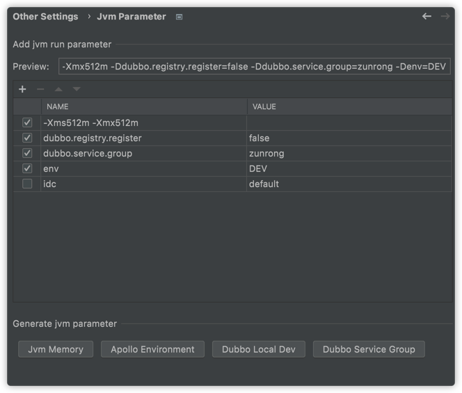

# jvm-parameter-intellij-plugin

_**State: The idea plugin has been migrated to the [RestfulBox](https://plugins.jetbrains.com/plugin/14723-restfulbox) plugin.**_

[简体中文](./README.zh_CN.md)

Manage jvm run parameter for your app conveniently. Enabled jvm parameters will be added to application run option when running.

If this plugin helps, please **🌟 Star** and [Rating](https://plugins.jetbrains.com/plugin/13204-jvm-parameter/reviews)! If you have any good idea, please let me know.

## Feature
- Project jvm parameter management.
- Global jvm parameter management, applied to all opened project.

## Install
- **Using IDE plugin system**

Recommended <kbd>Preferences(Settings)</kbd> > <kbd>Plugins</kbd> > <kbd>Browse repositories...</kbd> > <kbd>find "Jvm Parameter"</kbd> > <kbd>Install Plugin</kbd>

## Usage
After installed this plugin, you can add custom parameter in `Jvm Parameter` setting.

- Preview：preview enabled parameter (see multirow format when hover).
- Table column description

|Column Name|Description|
| --- | --- |
| ENABLE | Whether enable current row |
| NAME | Parameter key, not empty |
| VALUE | Parameter value. If empty, current row parameter will be NAME content |
| GLOBAL | Is global parameter |

- Generate jvm parameter: click `Preview` label to generate common parameter.
